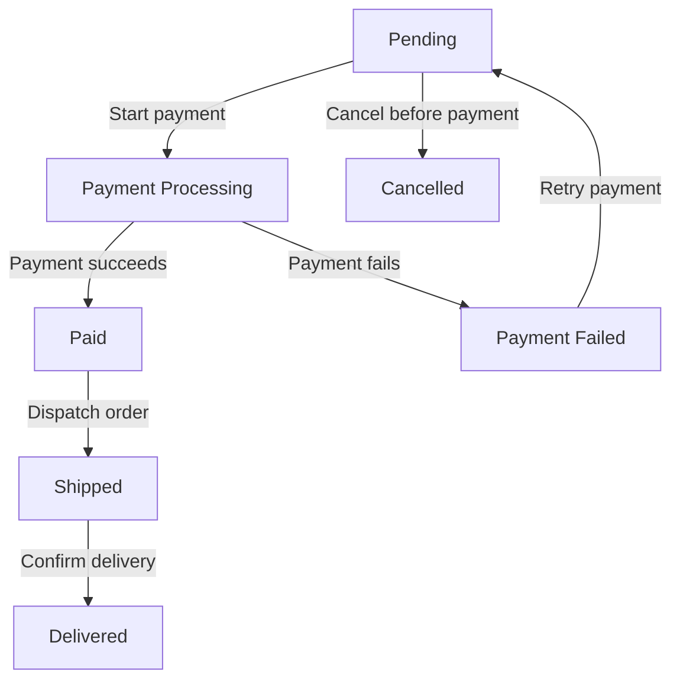

# Day 3 Practical Assessment — Decision Table and State Transition Testing

**Feature:** Registration and Checkout  
**Technique:** Black-box decision-table testing and state-transition testing  
**Execution status:** **NOT RUN** — designed examples only  
**Requirements:** [Assumed business rules](README.md)

## 1. Decision Table Testing — Checkout Coupon

### Business rule (exercise assumption)

A 10% coupon discount applies **only when all three conditions are true**:

1. Cart subtotal is **at least ৳1,000**.
2. The coupon is **valid**.
3. The user is **eligible** for the coupon.

Each condition has two possible values. Therefore, the complete table has **2 × 2 × 2 = 8 rules**.

| Rule | Subtotal ≥ ৳1,000? | Coupon valid? | User eligible? | Expected action |
| --- | --- | --- | --- | --- |
| DT-01 | Yes | Yes | Yes | Apply 10% discount |
| DT-02 | Yes | Yes | No | Reject discount |
| DT-03 | Yes | No | Yes | Reject discount |
| DT-04 | Yes | No | No | Reject discount |
| DT-05 | No | Yes | Yes | Reject discount |
| DT-06 | No | Yes | No | Reject discount |
| DT-07 | No | No | Yes | Reject discount |
| DT-08 | No | No | No | Reject discount |

### Test cases derived from the decision table

**Preconditions:** A test user exists with configurable eligibility; a valid and invalid coupon are available; cart subtotal fixtures of **৳1,000** and **৳999.99** are available.

**Common steps:** (1) Log in as the configured user; (2) prepare cart with specified subtotal; (3) apply selected coupon; (4) inspect discount, final amount, and validation message.

| Test ID | Test data | Expected result |
| --- | --- | --- |
| DT-01 | ৳1,000 subtotal, valid coupon, eligible user | Discount = ৳100; sample payable = ৳900 |
| DT-02 | ৳1,000 subtotal, valid coupon, ineligible user | No discount |
| DT-03 | ৳1,000 subtotal, invalid coupon, eligible user | No discount |
| DT-04 | ৳1,000 subtotal, invalid coupon, ineligible user | No discount |
| DT-05 | ৳999.99 subtotal, valid coupon, eligible user | No discount |
| DT-06 | ৳999.99 subtotal, valid coupon, ineligible user | No discount |
| DT-07 | ৳999.99 subtotal, invalid coupon, eligible user | No discount |
| DT-08 | ৳999.99 subtotal, invalid coupon, ineligible user | No discount |

**Actual results:** Not executed for any rule.

### Example: DT-02

**Given** a user who is not eligible for the coupon is on checkout  
**And** the subtotal is ৳1,000  
**And** the coupon code is valid  
**When** the user applies the code  
**Then** the 10% discount must **not** be applied.

**What I learned:** Even a valid code and sufficient subtotal are not enough if eligibility is false. A decision table makes these combinations explicit.

---

## 2. State Transition Testing — Checkout Order

### Business workflow (exercise assumption)

An order begins in the **Pending** state. The user can cancel before payment or start payment. A successful payment moves it to **Paid**. A failure moves it to **Payment Failed**; retry returns it to **Pending**. A Paid order can be shipped, and a Shipped order can be delivered.

### Valid and invalid transition test cases

**Common preconditions:** A controlled order can be placed in the current state, and an authorized test user can trigger the named action. Use a sandbox provider for payment outcomes.

| Test ID | Current state | Event / action | Expected state / outcome | Type |
| --- | --- | --- | --- | --- |
| ST-01 | Pending | Start payment | Payment Processing | Valid |
| ST-02 | Pending | Cancel order | Cancelled | Valid |
| ST-03 | Payment Processing | Payment succeeds | Paid | Valid |
| ST-04 | Payment Processing | Payment fails | Payment Failed | Valid |
| ST-05 | Payment Failed | Retry payment | Pending | Valid |
| ST-06 | Paid | Dispatch order | Shipped | Valid |
| ST-07 | Shipped | Confirm delivery | Delivered | Valid |
| ST-08 | Pending | Dispatch order | Reject; remain Pending | Invalid |
| ST-09 | Payment Failed | Mark shipped | Reject; remain Payment Failed | Invalid |
| ST-10 | Shipped | Cancel order | Reject; remain Shipped | Invalid |
| ST-11 | Delivered | Start payment again | Reject; remain Delivered | Invalid |
| ST-12 | Cancelled | Mark Paid | Reject; remain Cancelled | Invalid |

These are the assumed rules for the example system. A real application may support refunds, cancellations after shipping, or other states; its state model must be updated from the actual specification.

### Example: ST-10

**Given** an order is in the Shipped state  
**When** the customer attempts cancellation  
**Then** the cancellation is rejected under this exercise's assumed rule  
**And** the order remains Shipped.

**What I learned:** State transition testing checks not only what the system **allows**, but also what it **must prevent**.

---

## 3. Connecting the Techniques

| Technique | What it covers here |
| --- | --- |
| Decision table | Eligibility combinations controlling a coupon |
| State transition | Which status changes are valid during an order lifecycle |
| EP/BVA (separate file) | Quantity limits, input length, and coupon threshold |
| Existing advanced edge cases | Double clicks, refresh, slow network, session expiry, unusual values |

**Execution note:** All decision-table and state-transition cases remain **NOT RUN** until tested on an assigned application. Do not report PASS/FAIL without observation or evidence.
